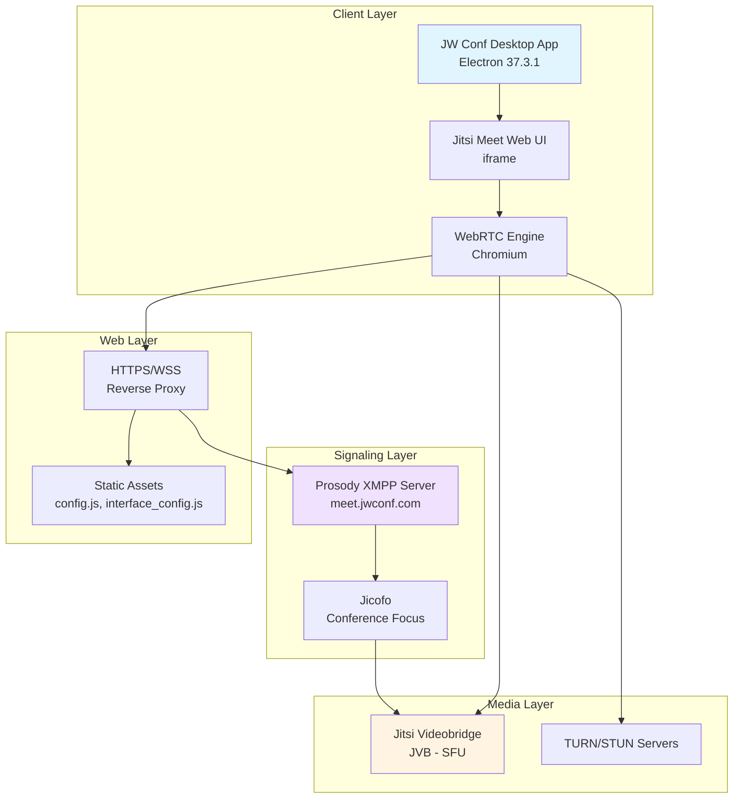
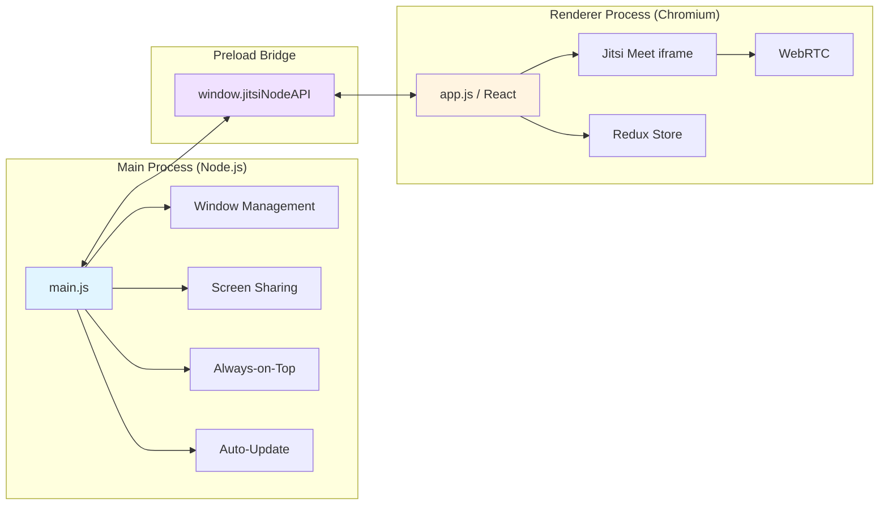
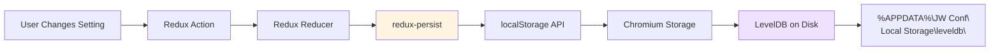
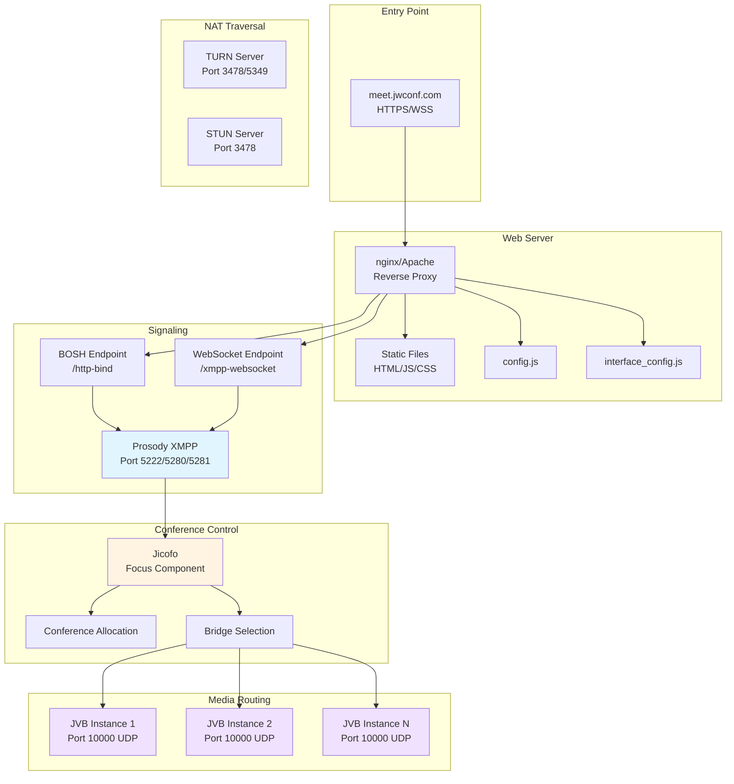
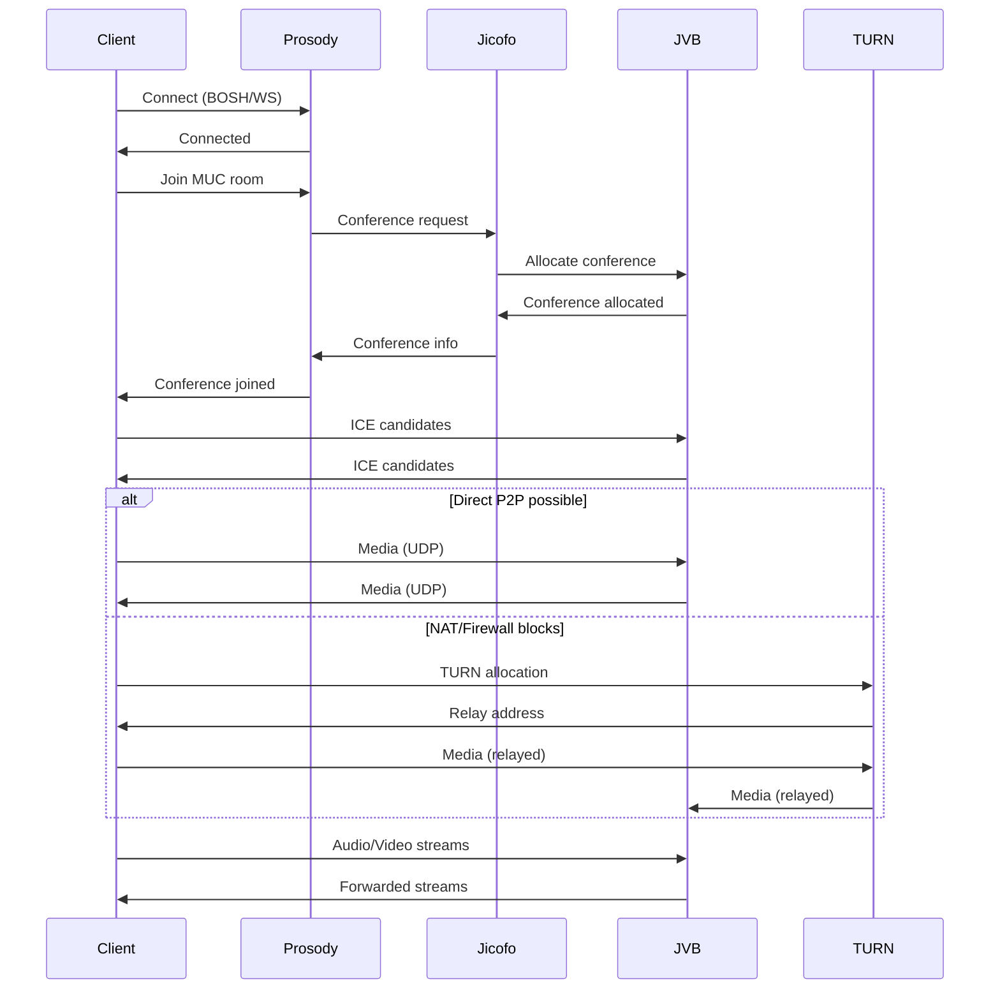
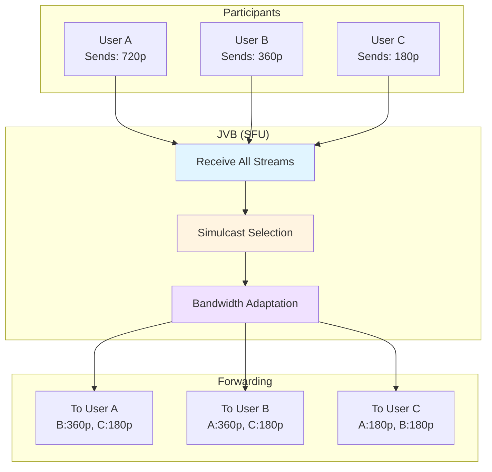
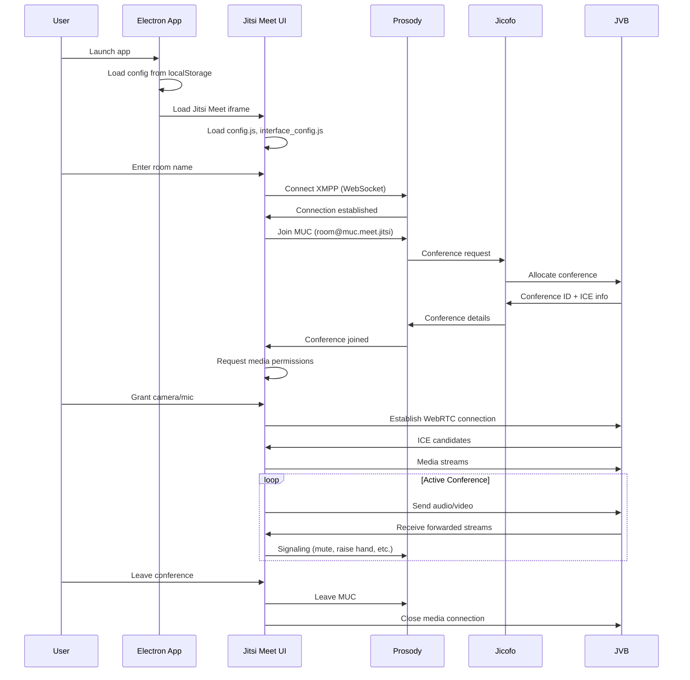
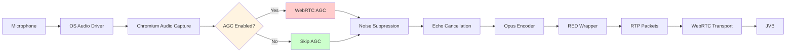

# JW Conf Architecture Documentation

**Last Updated**: January 27, 2026  
**App Version**: 2025.9.1  
**Backend**: Jitsi Meet (meet.jwconf.com)

---

## Table of Contents

1. [Overview](#overview)
2. [System Architecture](#system-architecture)
3. [Client Architecture](#client-architecture)
4. [Backend Architecture](#backend-architecture)
5. [Signaling & Media Plane](#signaling--media-plane)
6. [Configuration & Policies](#configuration--policies)
7. [Data Flow](#data-flow)
8. [Self-Hosting Options](#self-hosting-options)

---

## Overview

JW Conf is a customized Jitsi Meet Electron application designed for low-bandwidth video conferencing. The architecture follows a standard WebRTC SFU (Selective Forwarding Unit) pattern with Jitsi's proven infrastructure.

### Key Characteristics

- **Client**: Electron app (Chromium + Node.js) wrapping Jitsi Meet web UI
- **Backend**: Jitsi Meet stack (Prosody, Jicofo, JVB)
- **Signaling**: XMPP over BOSH or WebSocket
- **Media**: WebRTC with SFU architecture
- **Optimization**: Low-bandwidth policies (360p max, limited features)

---

## System Architecture



### Component Responsibilities

| Component | Role | Technology |
|-----------|------|------------|
| **Desktop App** | Native wrapper, OS integration | Electron 37.3.1 |
| **Jitsi Meet UI** | Conference interface, controls | React, Redux |
| **WebRTC Engine** | Media capture, encoding, transport | Chromium WebRTC |
| **Prosody** | XMPP signaling server | Prosody 0.11+ |
| **Jicofo** | Conference orchestration | Java |
| **JVB** | Media routing (SFU) | Java |
| **TURN/STUN** | NAT traversal | coturn or equivalent |

---

## Client Architecture

### Electron App Structure

```
JW Conf.app/
├── Contents/
│   ├── MacOS/JW Conf          # Electron binary
│   ├── Resources/
│   │   ├── app.asar            # Application code (8.9 MB)
│   │   │   ├── build/
│   │   │   │   ├── main.js     # Main process (Electron)
│   │   │   │   ├── app.js      # Renderer (React/Redux)
│   │   │   │   ├── preload.js  # Bridge script
│   │   │   │   └── index.html  # Entry point
│   │   │   └── node_modules/
│   │   │       └── @jitsi/electron-sdk@7.0.6
│   │   └── icon.png
│   └── Info.plist
```

### Process Architecture



### Key Dependencies

**Core**:
- `electron@37.3.1` - Desktop framework
- `@jitsi/electron-sdk@7.0.6` - Jitsi integration
- `react@17.0.2` - UI framework
- `redux@4.1.2` + `redux-persist@5.10.0` - State management

**Features**:
- `electron-store` / `conf` - Settings persistence
- `electron-context-menu` - Right-click menus
- `electron-window-state` - Window position memory
- `@atlaskit/*` - UI components

### Settings Persistence



**Storage Details**:
- **Key**: `persist:root`
- **Format**: JSON string
- **Slices**: `settings`, `recentList`, `onboarding`
- **Location**: `%APPDATA%\JW Conf\Local Storage\leveldb\` (Windows)
- **Location**: `~/Library/Application Support/JW Conf/` (macOS)

---

## Backend Architecture

### Jitsi Meet Stack



### Component Details

#### 1. Prosody XMPP Server
**Role**: Signaling and presence
- Manages XMPP connections (BOSH or WebSocket)
- Handles authentication (guest or JWT)
- Maintains conference room state
- Coordinates with Jicofo

**Configuration** (from `config.js`):
```javascript
config.hosts.domain = 'meet.jitsi'
config.hosts.muc = 'muc.meet.jitsi'
config.hosts.anonymousdomain = 'guest.meet.jitsi'
config.hosts.authdomain = 'meet.jitsi'
config.focusUserJid = 'focus@auth.meet.jitsi'
```

**Endpoints**:
- BOSH: `https://meet.jwconf.com/http-bind`
- WebSocket: `wss://meet.jwconf.com/xmpp-websocket`

#### 2. Jicofo (Conference Focus)
**Role**: Conference orchestration
- Allocates conferences to JVB instances
- Manages participant roles (moderator, participant)
- Handles lobby functionality
- Coordinates media sessions

#### 3. Jitsi Videobridge (JVB)
**Role**: Media routing (SFU)
- Receives media from all participants
- Selectively forwards streams to each participant
- Handles simulcast and adaptive bitrate
- Manages bandwidth allocation

**Key Features**:
- **SFU Architecture**: No transcoding, just forwarding
- **Simulcast**: Multiple quality layers per stream
- **Last-N**: Only forward N most active speakers
- **Bandwidth Estimation**: Adaptive quality based on network

#### 4. TURN/STUN Servers
**Role**: NAT traversal
- STUN: Discover public IP/port
- TURN: Relay media when P2P fails
- Fallback for restrictive firewalls

---

## Signaling & Media Plane

### Connection Establishment Flow



### Media Flow (SFU)



**JW Conf Specific Constraints**:
- Max resolution: **360p** (640x360)
- Ideal resolution: **360p**
- Min resolution: **180p** (320x180)
- Codec: **VP8** or **H.264**
- Audio: **Opus** with RED (redundancy)

---

## Configuration & Policies

### Server Configuration (`config.js`)

**Key JW Conf Customizations**:

```javascript
// Bandwidth optimization
config.resolution = 360
config.constraints = {
  video: {
    width: { ideal: 640, max: 640, min: 320 },
    height: { ideal: 360, max: 480, min: 180 }
  }
}

// Moderator controls
config.limitScreenSharingToModerators = true
config.enableModeratorUnmuteConsent = true

// Feature restrictions
config.speakerStats = { disabled: true }
config.disableRemoveRaisedHandOnFocus = true

// Lobby & display names
config.autoKnockLobby = true
config.requireDisplayName = true
config.defaultRemoteDisplayName = 'Guest'

// Advanced features
config.useNewBandwidthAllocationStrategy = true
config.enableIceRestart = true
```

### Client Configuration

**Electron Flags** (applied at startup):
```javascript
app.commandLine.appendSwitch("disable-site-isolation-trials")
app.commandLine.appendSwitch("disable-features", [
  "ThumbnailCapturerMac:capture_mode/sc_screenshot_manager",
  "ScreenCaptureKitPickerScreen",
  "ScreenCaptureKitStreamPickerSonoma"
])
app.commandLine.appendSwitch("force-fieldtrials", "WebRTC-Audio-Red-For-Opus/Enabled/")
app.commandLine.appendSwitch("enable-features", "WebRTCPipeWireCapturer")
```

**WebRTC Optimizations**:
- **Opus RED**: Redundant audio encoding for packet loss resilience
- **ICE Restart**: Automatic reconnection on network changes
- **Bandwidth Strategy**: Adaptive quality based on available bandwidth

---

## Data Flow

### Conference Join Flow



### Audio Processing Pipeline



**Windows AGC Issue**:
- When `disableAGC: false` (default), both WebRTC AGC and Windows driver AGC run
- Double-processing causes audio to "pump" or cut out
- **Solution**: Set `disableAGC: true` to skip WebRTC AGC

---

## Self-Hosting Options

### Option 1: Full Jitsi Meet Stack

**Components to Deploy**:
1. Jitsi Meet web application
2. Prosody XMPP server
3. Jicofo conference focus
4. Jitsi Videobridge (JVB)
5. TURN server (coturn)

**Pros**:
- Full control over infrastructure
- Custom branding and features
- No third-party dependencies
- Data sovereignty

**Cons**:
- Complex setup and maintenance
- Requires server infrastructure
- Scaling requires multiple JVB instances
- Network configuration (firewall, NAT)

**Estimated Costs**:
- **Small** (< 50 users): $50-100/month (single VPS)
- **Medium** (50-200 users): $200-500/month (multiple servers)
- **Large** (200+ users): $1000+/month (load-balanced JVBs)

**Quick Start**:
```bash
# Ubuntu/Debian quick install
curl https://download.jitsi.org/jitsi-key.gpg.key | sudo sh -c 'gpg --dearmor > /usr/share/keyrings/jitsi-keyring.gpg'
echo 'deb [signed-by=/usr/share/keyrings/jitsi-keyring.gpg] https://download.jitsi.org stable/' | sudo tee /etc/apt/sources.list.d/jitsi-stable.list
sudo apt update
sudo apt install jitsi-meet
```

### Option 2: Hybrid (Self-hosted Signaling + Managed TURN)

**Architecture**:
- Host Prosody + Jicofo + JVB yourself
- Use managed TURN service (Twilio, Xirsys, etc.)

**Pros**:
- Simpler NAT traversal
- Reduced infrastructure complexity
- Better global coverage for TURN

**Cons**:
- Ongoing TURN service costs
- Dependency on third-party for media relay

**Estimated Costs**:
- Self-hosted: $50-200/month
- TURN service: $0.01-0.05 per GB relayed

### Option 3: Custom SFU

**Build Your Own**:
- Use mediasoup, Pion, or other WebRTC SFU library
- Custom signaling (WebSocket, gRPC)
- Integrate with existing auth/user systems

**Pros**:
- Maximum flexibility
- Tight integration with existing systems
- Custom features and optimizations

**Cons**:
- Significant development effort
- Ongoing maintenance burden
- WebRTC expertise required

**Estimated Effort**:
- Development: 3-6 months (full-time)
- Maintenance: 1-2 engineers ongoing

### Option 4: Managed Jitsi (Jitsi as a Service)

**Providers**:
- 8x8 (official Jitsi provider)
- Jitsi.org free tier
- Other managed Jitsi hosts

**Pros**:
- Zero infrastructure management
- Automatic scaling
- Professional support

**Cons**:
- Monthly per-user costs
- Less customization
- Data hosted by third party

**Estimated Costs**:
- Free tier: Limited features, public rooms
- Paid: $5-15 per host per month

---

## Migration Path: JW Conf → Self-Hosted

### Phase 1: Deploy Backend (Week 1-2)

1. **Provision Infrastructure**
   - 1x server for Prosody + Jicofo (2 CPU, 4GB RAM)
   - 1x server for JVB (4 CPU, 8GB RAM, 1Gbps network)
   - 1x server for TURN (2 CPU, 4GB RAM)

2. **Install Jitsi Meet**
   - Follow official quick-start guide
   - Configure SSL certificates (Let's Encrypt)
   - Set up firewall rules (UDP 10000, TCP 443, 4443)

3. **Configure Custom Domain**
   - Point DNS to your servers
   - Update `config.js` with your domain
   - Test basic video calls

### Phase 2: Customize Configuration (Week 3)

1. **Apply JW Conf Policies**
   - Copy bandwidth constraints from `meet.jwconf.com/config.js`
   - Set resolution limits (360p max)
   - Enable moderator controls
   - Disable speaker stats

2. **Branding**
   - Update `interface_config.js` with your branding
   - Replace logo and watermark
   - Customize UI colors and text

3. **Test Thoroughly**
   - Verify all features work
   - Test with multiple participants
   - Check bandwidth usage

### Phase 3: Update Desktop App (Week 4)

1. **Modify Default Server**
   - Extract `app.asar` from JW Conf app
   - Update `defaultServerURL` in `build/main.js`
   - Repackage `app.asar`

2. **Rebuild Installers**
   - Use `electron-builder` to create installers
   - Sign with your code signing certificate
   - Test on Windows and macOS

3. **Distribute to Users**
   - Deploy via MDM or manual download
   - Provide migration instructions
   - Monitor for issues

### Phase 4: Optimize & Scale (Ongoing)

1. **Monitor Performance**
   - Set up Prometheus + Grafana for JVB metrics
   - Track bandwidth, CPU, participant counts
   - Identify bottlenecks

2. **Scale JVB Horizontally**
   - Add more JVB instances as needed
   - Configure Jicofo for load balancing
   - Use OCTO for cascading (multi-region)

3. **Optimize Costs**
   - Right-size server instances
   - Use spot/preemptible instances where possible
   - Implement auto-scaling

---

## Performance Considerations

### Bandwidth Requirements

**Per Participant** (JW Conf 360p limits):
- **Sending**: ~500 Kbps (360p video + audio)
- **Receiving**: ~500 Kbps per visible participant
- **Total**: 500 Kbps + (500 Kbps × N visible participants)

**Example** (5-person conference):
- Each participant sends: 500 Kbps
- Each participant receives: 2000 Kbps (4 × 500)
- Total per participant: **2.5 Mbps**

**Server Bandwidth** (JVB):
- Receives: 500 Kbps × N participants
- Sends: 500 Kbps × N × (N-1) connections
- **Example** (10 participants): ~45 Mbps total

### CPU Requirements

**Client**:
- Video encoding: 10-20% CPU per stream
- Video decoding: 5-10% CPU per stream
- Audio processing: 1-2% CPU

**Server (JVB)**:
- Minimal CPU (no transcoding)
- ~1-2% CPU per participant
- Network I/O is the bottleneck

### Scaling Limits

**Single JVB Instance**:
- **Recommended**: 50-100 participants per conference
- **Maximum**: 200-300 participants (with good network)
- **Bottleneck**: Network bandwidth (1Gbps = ~200 participants)

**Multi-JVB Setup**:
- Use OCTO for cascading bridges
- Distribute participants across JVBs
- Scale to 1000+ participants

---

## Security Considerations

### Authentication

**Current** (JW Conf):
- Guest access (no authentication)
- Moderator can enable lobby
- No JWT or SSO integration

**Self-Hosted Options**:
- JWT tokens for authenticated users
- LDAP/Active Directory integration
- SSO via SAML or OAuth

### Encryption

**In Transit**:
- HTTPS for web traffic
- WSS for WebSocket signaling
- DTLS-SRTP for media (WebRTC)

**At Rest**:
- No recording by default
- If recording enabled, encrypt storage

### Network Security

**Firewall Rules**:
- Allow TCP 443, 4443 (HTTPS, WSS)
- Allow UDP 10000 (JVB media)
- Allow TCP/UDP 3478, 5349 (TURN)
- Block all other ports

**DDoS Protection**:
- Use Cloudflare or similar CDN
- Rate limit signaling connections
- Monitor for abuse

---

## Monitoring & Observability

### Key Metrics

**JVB**:
- Active conferences
- Active participants
- Bandwidth usage (in/out)
- Packet loss rate
- CPU and memory usage

**Prosody**:
- Active XMPP connections
- MUC room count
- Message throughput

**Client**:
- Connection quality (RTT, jitter, loss)
- Audio/video bitrate
- Frame rate and resolution

### Recommended Tools

- **Prometheus + Grafana**: Metrics and dashboards
- **ELK Stack**: Log aggregation and search
- **Sentry**: Error tracking
- **WebRTC Stats**: Built-in `chrome://webrtc-internals`

---

## References

- **Jitsi Meet Handbook**: https://jitsi.github.io/handbook/
- **Jitsi Videobridge**: https://github.com/jitsi/jitsi-videobridge
- **Prosody XMPP**: https://prosody.im/doc/
- **WebRTC Specs**: https://www.w3.org/TR/webrtc/
- **JW Conf Analysis**: [WINDOWS_ANALYSIS.md](WINDOWS_ANALYSIS.md)

---

*Architecture documented by: Community Contributors*  
*Last updated: January 27, 2026*
